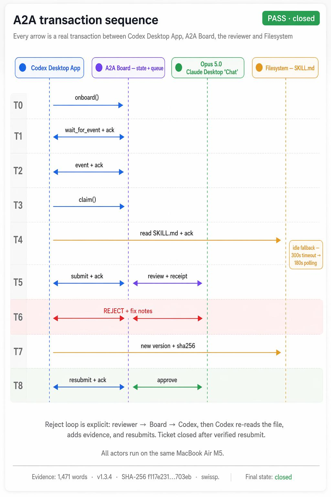

# On Board

<!-- mcp-name: io.github.swisspra/On_Board -->

> Shared project memory for agents.
> One MCP server, one project memory folder, many IDEs and agent clients.
> Skill-first setup, one shared runtime, and project-scoped configuration.

[](LICENSE)
[](https://modelcontextprotocol.io)
[](https://lobehub.com/mcp/swisspra-on_board)
[](https://github.com/swisspra/On_Board/releases/latest)
[](#agent-to-agent-the-listening-half-v4)

---

## What this is

On Board is a local MCP server for coordinating AI agents across a project.
It gives Claude Desktop, Claude Code, Codex, Cursor, Antigravity, and other
MCP clients the same project memory, ticket queue, and handoff history.

The goal is simple: when one agent stops and another agent continues, the next
agent should not need the human to explain the project again.

```
onboard → read memory → claim work → write progress → hand off
```

Everything stays local to the project unless you choose to connect other tools.

---

## Quick start (skill-first)

Install the `onboard` skill from inside the project you want to configure:

```bash
# Node.js 22.20 or later; select your agent when prompted.
npx skills add swisspra/On_Board --skill onboard
```

`npx` runs the skills CLI from npm; the skill itself comes from Git. No separate
On Board npm package is needed. The skill guides runtime installation and native
client configuration; installing the skill alone does not start an MCP server,
upgrade an existing shared runtime, or initialize memory.

Native resources require a verified **4.2+** runtime. A working 4.1.1 or source
installation can stay in place; see [runtime upgrades](./docs/SETUP.md#skill-updates-and-runtime-upgrades)
or the [optional source runtime](./docs/SETUP.md#runtime-from-source-optional).

Then send your agent this prompt:

```text
Using /onboard, set up On Board for this project. Keep existing memory and other MCP servers unchanged.
```

The `/onboard` skill reuses one shared `onboard-memory-mcp` runtime and
configures **one project** — the one you run it in — for **one client** of your
choice. It resolves an existing runtime first and installs the shared runtime
only when none is present (reuse, not a per-project install). It reads and writes
only that project's own MCP config. It does not initialize or migrate
`.agent-mem/`, and it does not touch other MCP servers, your instructions, or
hooks.

What happens, in order:

1. **Reload your agent** after the install so it discovers the new `/onboard`
   skill (reopen the window, or start a new session).
2. The skill resolves or installs the shared runtime and writes the project's
   MCP config.
3. **Trust and restart your MCP client** so it loads the new `agent-memory`
   server. Some clients ask before running a newly added server; approve the
   prompt, then restart.

Prerequisites are real, not hidden behind a one-command promise:

- **Node.js ≥ 22.20** to run `npx skills`.
- **Setup helper: Python ≥ 3.11.** The skill's `scripts/setup.py` needs it; where
  the machine's `python3` is older, run the one-time helper with
  `uv run --no-project --python 3.12 scripts/setup.py …`.
- **Runtime: Python ≥ 3.10**, plus [`uv`](https://docs.astral.sh/uv/) or `pipx`
  already installed, for the `onboard-memory-mcp` runtime the skill installs.

Runtime states, so you know where you are: **Runtime available** (the runtime is
resolved or installed) → **Configured** (the project's MCP config now points at
it) → **Awaiting trust or restart** (the client has not loaded it yet) →
**Ready** (the client shows the `agent-memory` tools). Setup ends at Ready;
initializing or joining a board is a separate step, started only when you
explicitly ask the agent to begin work.

Prefer to wire things by hand, or install from a package manager or a clone?
Those paths stay fully supported — see [Manual installation](#manual-installation)
and [docs/SETUP.md](./docs/SETUP.md).

---

## 🚀 v4.0.0 — agents now wake each other

Until v4 this board was pull-only: an agent found out about new work when a
human told it to look. **v4 ships `memory_wait_for_event`** — an agent parks
inside one tool call and wakes the moment a peer creates a ticket, submits
work, or delivers a verdict.

This is not a demo claim. In the launch trial, **a GPT agent (Codex) and a
Claude agent closed a full reject → fix → resubmit cycle on this board with
zero human relay** — the reviewer's fix instructions travelled inside the wake
payload, the worker re-read the file, attached a sha256, and resubmitted; the
reviewer reproduced the hash byte-for-byte before approving:



Full mechanics in [Agent-to-agent: the listening half](#agent-to-agent-the-listening-half-v4) ·
breaking changes in [CHANGELOG.md](./CHANGELOG.md) ·
[release notes](https://github.com/swisspra/On_Board/releases/tag/v4.0.0).

## Why this exists

Most agent workflows break for boring reasons:

- The next chat does not know what the last chat did.
- Parallel agents overwrite or redo each other's work.
- Important decisions live only in conversation history.
- Handoffs are informal, so review and follow-up work drift.

On Board keeps those facts in project-local files under `.agent-mem/`.
The MCP tools expose that memory to any supported client.

## Who this is for

- Solo developers using more than one agent or IDE
- Teams experimenting with multi-agent coding workflows
- Projects where handoffs, tickets, and review notes matter
- Local-first MCP users who want shared context without a hosted service

It is not an autonomous project manager. Humans still decide what matters,
review important changes, and accept the final result.

---

## Manual installation

These paths stay supported; they are just secondary to the skill-first quick
start above. Use them to install from a package manager, or to run everything
from a clone by hand.

### Install the server

The server is published as [`onboard-memory-mcp`](https://pypi.org/project/onboard-memory-mcp/).
Install it with whichever tool you prefer:

```bash
# Homebrew (tap once, then the short name works: brew install onboard-memory)
brew install swisspra/tap/onboard-memory

# pipx
pipx install onboard-memory-mcp

# uv
uv tool install --python 3.12 onboard-memory-mcp
```

All three provide the `onboard-memory-mcp` command (Homebrew also adds a short
`onboard-memory` alias). Homebrew covers macOS and Linux; on **Windows** use
pipx or uv (the command is `onboard-memory-mcp.exe`). Point your MCP client's
`command` at it instead of `python3 onboard_server.py`. You can also skip this
and run from a clone using the setup paths below. (On Homebrew 6+, approve the
one-time tap-trust prompt, or run `brew trust swisspra/tap`.)

The v4.2.0 runtime uses `mcp[cli]>=2.3.0,<3` and the SDK's `MCPServer`
API. The lockfile selects MCP 2.3.0; SDK 1.x is no longer supported.
Minimum AnyIO, PyJWT, and cryptography versions also prevent installers from
retaining known-vulnerable transitive dependencies.

#### Headless config (no clone)

With the server installed, wire your MCP client to it directly — no repo
checkout, no `setup-project.sh`:

```json
{
  "mcpServers": {
    "agent-memory": {
      "command": "onboard-memory-mcp",
      "env": { "AGENT_PROJECT_DIR": "/full/path/to/your/project" }
    }
  }
}
```

- **CLI clients** (Claude Code, Codex) inherit your shell `PATH`, so the bare
  `onboard-memory-mcp` works.
- **GUI clients** (Claude Desktop, Cursor) launch with a minimal `PATH`. Use the
  absolute path from `which onboard-memory-mcp` (`where` on Windows) as
  `command` — typically `/opt/homebrew/bin/onboard-memory-mcp` (Homebrew, Apple
  Silicon), `/usr/local/bin/onboard-memory-mcp` (Homebrew, Intel),
  `/home/linuxbrew/.linuxbrew/bin/onboard-memory-mcp` (Homebrew, Linux),
  `~/.local/bin/onboard-memory-mcp` (pipx / uv on macOS/Linux), or
  `%USERPROFILE%\.local\bin\onboard-memory-mcp.exe` (pipx / uv on Windows).

`AGENT_PROJECT_DIR` is required — it decides which project owns `.agent-mem/`.
Nothing here initializes memory: starting work is a separate step. In your first
work session, call `memory_init` once (creates `.agent-mem/`) — or
`memory_bootstrap` when adopting an existing repo — then `memory_onboard` each
session. If `.agent-mem/` already exists, never bootstrap it again; just join.

The `pipx`/`uv` path normally uses prebuilt dependency wheels on supported
CPython 3.11+ platforms. Wheel availability depends on Python and architecture;
Python 3.10 or Intel macOS may need a C/Rust toolchain. Homebrew bottle builds
target ARM macOS and x86_64 Linux. Upstream dependency bottles are currently
unavailable for Intel macOS, so Homebrew is not a compiler-free fallback there.
Template: [configs/binary-mcp.json](./configs/binary-mcp.json); full detail and
platform notes in [docs/SETUP.md](./docs/SETUP.md).

### Set up a project

Choose one setup path:

#### Option 1: Agent setup

The [skill-first quick start](#quick-start-skill-first) above is the recommended
path. If you would rather not use the skill CLI, ask an agent to read
[AGENT_SETUP.md](./AGENT_SETUP.md) — it delegates to the canonical install
reference instead of inventing a second recipe — and to
[docs/SETUP.md](./docs/SETUP.md) for the manual steps.

#### Option 2: Script setup

```bash
git clone https://github.com/swisspra/On_Board.git
cd On_Board
bash setup-project.sh /full/path/to/your/project
bash doctor.sh /full/path/to/your/project
```

Add the generated MCP config to your client:

```text
/full/path/to/your/project/.onboard/mcp.generated.json
```

Some clients accept this JSON directly. Others require you to merge it into
their own MCP settings file.

After memory is initialized, open the dashboard with:

```bash
bash /full/path/to/your/project/.onboard/run-dashboard.sh
```

On Board is installed once. Each project points to the same On Board folder,
but gets separate memory through `AGENT_PROJECT_DIR`.

Each `setup-project.sh` run also registers the project locally in
`.onboard/linked-projects.json` inside the On Board checkout. This file is
gitignored and only helps updates remember which projects point here.

The setup script uses `uv sync --inexact` to install/update dependencies without
pruning local test/dev extras. MCP clients run `python3 onboard_server.py`; the
launcher uses the local `.venv` directly and rebuilds it only if the venv is
missing. This keeps normal startup fast, avoids `uv run` startup timeouts, and
makes a shared central checkout more durable.

On Board does not write memory from end-turn hooks. Current `Stop` hooks in
several agent clients run every turn, which creates noisy memory and can force
agents to re-onboard too often.

Optional: add `AGENT_MEM_CONTEXT_DIRS` to the generated MCP config when agents
should read shared docs/specs outside the project folder.

#### Option 3: Advanced manual setup

If you do not want to run the setup script, install with `uv sync`, write the
MCP config yourself, and add project rules/hooks manually. See
[docs/SETUP.md](./docs/SETUP.md).

Setup stops at the config; nothing above initializes memory. When you later
start work in the project — a separate, explicit request — do it in a chat with
any MCP-aware agent (Claude Desktop, Claude Code, Cursor, Codex, Antigravity).
Skip `memory_bootstrap` if `.agent-mem/` already exists and just join:

```
memory_bootstrap(
  agent_name="dev-main",
  description="Existing project using On Board",
  current_task="Set up shared project memory"
)

memory_onboard(
  agent_name="dev-main",
  agent_platform="claude-code",
  agent_role="main"
)
```

That's it. The agent now sees the project briefing, the open tickets, the
recent memory, and the protocol it should follow. Every subsequent action
is stamped with its identity.

Full setup details and manual setup: see
[docs/SETUP.md](./docs/SETUP.md).

To update an existing install, run `bash update.sh` in the central On Board
checkout. It will show known linked projects. Refresh all of them with
`bash update.sh --refresh-linked`, or inspect them with
`bash setup-project.sh --list-linked`.

---

## The loop in one example

```
1. SPEC
   opus-testcase reads requirement → writes 5–20 acceptance tickets
   with explicit pre/post conditions.

2. BUILD
   dev-track-2 claims a ticket → implements in src/ → submits with
   file diff + test plan.

3. TEST
   Jonhny-tester picks up submission → runs UI in Chromium → captures
   screenshots → submits PASS or FAIL with evidence.

4. REVIEW
   desktop-opus4.7 (or the human) checks evidence → approves OR rejects
   with concrete fix instructions.

   If rejected → ticket reopens → dev-track-2 patches → Jonhny retests
   → loop closes.
```

When this loop runs cleanly, a single ticket goes from `open` to "shipped
to production" in 4–15 minutes of agent time. The human checks in at the
end, not in the middle.

---

## Agent-to-agent: the listening half (v4)

Everything above still works pull-style. v4 adds the missing edge: agents can
now **wake each other** instead of waiting for a human to relay messages.

```
worker:  memory_wait_for_event(agent_name="dev-track-2", timeout_s=180)
         → parks inside one tool call until the board changes
lead:    memory_create_ticket(..., assigned_to="dev-track-2")
worker:  wakes in seconds, claims, works,
         memory_submit_ticket(..., stay_active=True)
lead:    wakes on the submission, reviews
worker:  wakes on the verdict — approve closes the loop;
         a rejection arrives WITH the review notes and fix
         instructions in the wake payload, so it re-claims,
         fixes, and resubmits without asking anyone
```

Design points, all field-verified across Claude Desktop × Claude Desktop and
Claude × Codex (GPT):

- **Check before blocking** — a re-arm after a gap returns its backlog in 0 s
  instead of waking empty. One wake drains the whole queue.
- **Loop guard** — an agent never wakes on its own actions, so two listeners
  cannot ping-pong each other.
- **Role gate** — *completed ≠ success*: whoever executed a ticket may reach
  `submitted` but may never close it; only the owner or a main/lead/reviewer
  adjudicates. Solo use is still possible via explicit `allow_self_review=True`,
  permanently stamped in the audit.
- **Client limits respected** — Claude Desktop cancels tool calls at ~240 s
  *per call* (measured), so timeouts clamp to 200 s there; stdio clients
  (Claude Code, Codex) may pass `long_wait` and park much longer.
- **Idle budget, in minutes** — the server counts consecutive empty parks and
  answers `STAND-DOWN` once `idle_budget_min` (default 15) is spent, so an
  unattended listener stops on its own instead of looking wedged. Budgets are
  stated in minutes because a human watching a silent loop counts wall clock,
  not iterations — a compliant agent looping for 20 minutes looks stuck even
  when it is exactly on budget. Every idle reply prints `idle 3/5 — ~6 min to
  stand-down`. The counter resets on a real event and never on re-arming, and
  `STAND-DOWN` is a distinct status so a loop matching on `idle` cannot read it
  as permission to continue. `idle_budget_min=0` listens indefinitely.
- Use the `listen` MCP prompt for the standard re-arm loop.

v4 also hardens the board for simultaneous writers (advisory lock on ticket
mutations, per-process tmp files), because with A2A two agents acting in the
same instant is the normal case, not the rare one. Breaking changes and the
migration guide live in [CHANGELOG.md](./CHANGELOG.md).

---

## Tools (30 MCP tools, 5 buckets)

| Bucket | Tools |
|---|---|
| **Agent lifecycle** | `memory_onboard`, `memory_agent_join`, `memory_handoff`, `memory_checkpoint`, `memory_get_briefing`, `memory_wait_for_event` |
| **Ticket queue** | `memory_create_ticket`, `memory_claim_ticket`, `memory_submit_ticket`, `memory_review_ticket`, `memory_cancel_ticket`, `memory_terminate_ticket`, `memory_list_tickets` |
| **Persistent memory** | `memory_write`, `memory_unpin`, `memory_read`, `memory_search`, `memory_search_vector`, `memory_links` |
| **Project context** | `memory_init`, `memory_bootstrap`, `memory_status`, `memory_doctor`, `memory_update_state`, `memory_context_dirs`, `memory_context_read` |
| **Compaction** | `memory_prepare_compaction`, `memory_compact`, `memory_token_usage`, `memory_search_archive` |

Full reference: [docs/TOOLS.md](./docs/TOOLS.md).

### Native resources (v4.2.0)

Three read-only JSON resources are exposed for clients that read MCP resources:
`onboard://project`, `onboard://tickets`, and `onboard://memory/summary`. They
return bounded projections (no raw memory bodies) and never create or modify a
board.

Every resource read is live state with a private `ttlMs 0` hint; only the static
response catalogs use `ttlMs 60000`. Clients that support resource subscriptions
and honor them get a coalesced `ResourceUpdated` invalidation notice when any of
the three resources change. That is a re-read cue — not durable delivery and not
a model wake-up; there is no replay. Use `memory_wait_for_event` when an agent
must actually be woken by a peer.

On Board ships no MCP App (`ui://`) view this round: a host-rendered view is not
a dependable wake mechanism, and not every host — CLI clients in particular —
renders apps. See [docs/TOOLS.md](./docs/TOOLS.md#resources).

---

## What makes this different

On Board is not only a place to store memories. It keeps the work loop visible:

```text
onboard -> claim ticket -> submit evidence -> review -> approve or reopen
```

That gives agents a shared queue, stable identities, recent handoffs, and a
review gate. Rejected work reopens with fix instructions instead of becoming a
dead terminal state.

---

## Project structure (runtime data)

```
your-project/
├── .agent-mem/                runtime memory, gitignored
│   ├── project.json
│   ├── agents.json            agent registry (identity, status, KIA)
│   ├── memories.json
│   ├── state.json             project phase, owner, design defaults
│   ├── archive.json
│   ├── digests.json
│   ├── checkpoints/
│   └── tickets/
│       ├── _index.json
│       ├── TK-<id>.md                      the spec
│       ├── review/TK-<id>-submit.md        dev submission
│       ├── closed/                         approved work
│       └── rejected/<ticket_id>/attempt-<N>/
│           ├── <ticket_id>.md              rejected spec for that round
│           ├── <ticket_id>-submit.md       submission under review
│           └── <ticket_id>-rejected.md     reviewer notes + fix instructions
```

Everything is plain text or JSON. You can `cat` your way through the
project's full history. No vector DB lock-in, no opaque embeddings — just
files an audit can read.

---

## Current status (v4.2.0)

The primary skill-first route reuses one shared `onboard-memory-mcp` runtime —
installed once and reused by every configured project, each with its own
project-selected memory folder. A central On Board checkout stays a supported
secondary path:

- The skill-first command above is the primary installation
  entry; a project is configured with the `/onboard` skill for one chosen client,
  reusing an existing runtime and installing the shared runtime only when none is
  present. Memory is never initialized or migrated by the installer.
- Three read-only native resources (`onboard://project`, `onboard://tickets`,
  `onboard://memory/summary`) expose bounded project, ticket, and memory
  projections. All three reads carry a private `ttlMs 0` hint (only the static
  catalogs use `ttlMs 60000`); subscription notifications are a
  capability-dependent re-read cue, not a model wake-up. They exist only on a
  verified v4.2+ runtime.
- `memory_onboard` is the primary start call for agents and returns compact current context.
- `memory_wait_for_event` turns the board push-capable: agents park, wake on peer
  actions, and close reject/retry loops with zero human relay (see the A2A section).
- `memory_doctor` checks board health and data integrity — a diagnostic, not a
  setup gate.
- The secondary source route runs `setup-project.sh`, which generates project MCP
  config, rules, startup hooks, and a dashboard launcher.
- Linked-project registry tracks which projects point at the central checkout,
  so updates can refresh known projects without scanning the machine.
- In that source route, runtime startup uses `python3 onboard_server.py`; the
  launcher normally execs `.venv/bin/python server.py` and only falls back to
  `uv sync --inexact` if `.venv` is missing. The primary route points clients at
  the installed `onboard-memory-mcp` executable instead of the source launcher.
- Existing working 4.1.1 or source-based bindings keep working unchanged; the
  skill asks before replacing a shared runtime, and it never upgrades one
  unsolicited.
- Startup hooks return a small read-only briefing. End-turn/Stop hooks are not
  installed by default because current clients can run them too often.
- The dashboard is local and read-only.

Full CHANGELOG: [CHANGELOG.md](./CHANGELOG.md).

---

## License

Apache-2.0. Free to use, fork, modify, redistribute, build commercial
products on. No restrictions on use.
